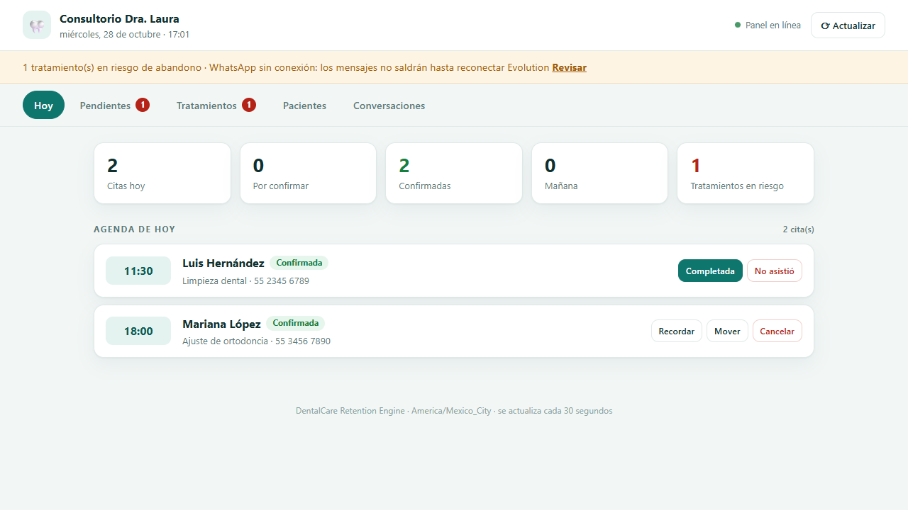

# DentalCare Retention Engine 🦷

Motor de automatización para un consultorio dental pequeño (Dra. Laura + 1 asistente).
Ataca tres pérdidas concretas:

1. **~30 % de inasistencias** en citas agendadas.
2. **Abandono de tratamientos multisesión** (endodoncia, ortodoncia, prótesis) cuando deja de doler.
3. **Mañanas perdidas** enviando recordatorios a mano por WhatsApp.

> Fuera de alcance por diseño: facturación y expediente clínico digital.
>
> **¿Primera vez con el proyecto?** Sigue la guía completa
> **[PASO_A_PASO.md](PASO_A_PASO.md)**: requisitos, base de datos, WhatsApp, Google
> Calendar, pruebas y puesta en producción.

---

## Cómo funciona (en una frase por pieza)

- **Google Calendar manda.** Se sincroniza a Postgres cada mañana; la base permite razonar sobre citas, y los cambios del paciente se escriben de vuelta al calendario.
- **Recordatorios escalonados** a 3 días, 24 h, 2 h y el mismo día. Los dos primeros llevan botones *Sí asistiré / Necesito cambiarla*.
- **NLU en tres capas**: botón → reglas en español → LLM **solo si hace falta**. Sin API key el sistema funciona igual (y es predecible).
- **Seguimiento multisesión** con protocolos por tratamiento: avisa *antes* de que venza el intervalo y alerta a la asistente cuando ya hay retraso.
- **Panel para la asistente** en `/panel`: agenda del día, pendientes, tratamientos en riesgo y conversaciones, con acciones en un clic.
- **Todo lo dudoso se escala a un humano.** El bot no diagnostica ni negocia tratamientos.

---

## Stack

| Capa | Tecnología | Nota |
|------|-----------|------|
| Runtime | Node.js 20+ / TypeScript (ESM) | `strict: true` |
| Base de datos | PostgreSQL 16 + Prisma 6 | fuente de verdad operativa |
| Cola de tareas | **tabla `recordatorios_envios` + cron** | sin Redis: ver *Decisiones* |
| WhatsApp | Evolution API v2 (autohospedada) | webhook + `sendText` / `sendButtons` |
| NLU | reglas deterministas + LLM opcional | OpenAI o cualquier API compatible (Ollama, Groq, LM Studio) |
| Agenda | Google Calendar API (OAuth2 + refresh token) | |
| Panel | Express + HTML/CSS/JS sin framework | sin build, servido en `/panel` |
| Scheduler | node-cron, zona del consultorio | |
| Pruebas | Vitest + Supertest | 110 pruebas, sin infraestructura |

---

## Arranque rápido (local)

Requisitos: Node 20+, Docker Desktop (o un PostgreSQL 16 propio).

```bash
# 1. Dependencias y entorno
npm install
cp .env.example .env          # completar credenciales reales

# 2. Base de datos
docker compose up -d postgres
npm run db:migrate            # crea el esquema
npm run db:seed               # tratamientos + pacientes de demostración

# 3. Servidor
npm run dev                   # http://localhost:3000
```

Abre **http://localhost:3000/panel** para el panel de la asistente. Sin
`PANEL_PASSWORD`, el panel sólo acepta peticiones desde localhost.

Verificación sin credenciales externas:

```bash
npm run demo     # conversación completa con dobles en memoria (no toca la BD)
npm test         # 110 pruebas
npm run build    # compila a dist/
```

`GET /health` dice la verdad: estado de Postgres, de la instancia de WhatsApp y qué LLM está activo.

---

## Configuración

### 1. WhatsApp (Evolution API)

```bash
docker compose up -d evolution-api   # usa Postgres, no necesita Redis
```

- Abre `http://localhost:8080/manager`, crea la instancia `consultorio-laura` y escanea el QR con el teléfono del consultorio.
- Configura el webhook de la instancia a `http://<tu-host>:3000/webhook/whatsapp`, evento `MESSAGES_UPSERT`.
- Si defines `EVOLUTION_WEBHOOK_SECRET`, el webhook exige la cabecera `x-webhook-secret` (comparación en tiempo constante).
- La base guarda los **últimos 10 dígitos** del paciente y `WHATSAPP_PAIS` (52 por defecto) se antepone al enviar, porque Evolution exige el número con lada.

### 2. Google Calendar

```bash
npm run oauth            # guarda GOOGLE_REFRESH_TOKEN en .env
npm run sync:calendar    # prueba la conexión
```

- Credenciales OAuth de tipo **Aplicación de escritorio** en Google Cloud Console, con *Google Calendar API* habilitada.
- **Convención de título:** `Nombre del paciente - motivo`, por ejemplo `Ana Ruiz - endodoncia`.
  Un evento con otro formato se ignora al sincronizar (mejor ignorar que inventar pacientes).
- `CALENDAR_IDS` acepta varios calendarios separados por coma.

### 3. LLM (opcional)

Sin `LLM_API_KEY`, el motor usa solo reglas: cubre "sí", "no puedo, cámbiamelo para el jueves", "cancelar", precios, horarios y dirección. Con clave, los mensajes ambiguos pasan al modelo.

```env
# OpenAI
LLM_PROVIDER=openai
LLM_BASE_URL=https://api.openai.com/v1
LLM_MODEL=gpt-4o-mini
LLM_API_KEY=sk-...

# Ollama local (mismo código, otra URL)
LLM_BASE_URL=http://localhost:11434/v1
LLM_MODEL=llama3.2:3b
LLM_API_KEY=ollama
```

---

## Panel de la asistente



**http://localhost:3000/panel** — una sola página, sin React ni build: se sirve
desde `public/` y habla con `/api/panel`. Está pensada para tablet: botones
grandes, sin menús escondidos.

| Pestaña | Para qué sirve |
|---------|----------------|
| **Hoy** | Agenda del día con estado real de cada cita y acciones: confirmar, recordar, mover, cancelar, marcar completada o no-show. |
| **Pendientes** | Lo que requiere decisión humana: citas sin confirmar en 48 h, tratamientos pasados de intervalo y conversaciones sin responder. |
| **Tratamientos** | Todos los tratamientos multisesión con días transcurridos, retraso y severidad; botón para enviar el seguimiento. |
| **Pacientes** | Búsqueda por nombre/teléfono, alta o corrección del **teléfono**, próxima cita, última visita y **consentimiento de WhatsApp** (al activarlo se programan sus recordatorios). |
| **Conversaciones** | Historial por paciente y respuesta manual desde el panel; respeta el consentimiento igual que el bot. |

Detalles que importan en el uso diario:

- **Mover una cita** abre un diálogo con fecha/hora: mueve el mismo evento de
  Google Calendar, recalcula los recordatorios y avisa al paciente. Si el aviso
  falla, la cita se mueve igual y el panel lo dice para que la asistente lo haga
  a mano.
- **Errores de WhatsApp en lenguaje humano.** Si Evolution está caído, la
  franja superior lo avisa y los envíos fallan en segundos, no en 30.
- **No se refresca mientras escribes.** El auto-refresco de 30 s se pausa si hay
  un campo enfocado o un diálogo abierto, para no borrar un mensaje a medias.
- **Todo sale de Postgres.** El panel no inventa citas ni pacientes: si no está
  en la base (y por tanto en el calendario), no aparece.

### Seguridad

```env
PANEL_USER=asistente
PANEL_PASSWORD=una-clave-larga
```

- Con `PANEL_PASSWORD`, `/panel` y `/api/panel` piden **HTTP Basic** (comparación
  en tiempo constante). El navegador pide las credenciales una vez.
- **Sin** contraseña, el panel sólo responde a `127.0.0.1`/`::1`; en producción
  eso significa que queda cerrado si está detrás de un proxy.
- El webhook y `/health` siguen siendo públicos (el webhook se protege con
  `EVOLUTION_WEBHOOK_SECRET`).
- Para exponerlo fuera de la red local, ponlo detrás de HTTPS (Caddy, nginx o
  Tailscale). Basic sin TLS no es aceptable con datos de pacientes.

---

## Operación diaria

| Hora | Tarea |
|------|-------|
| cada 5 min | envía recordatorios vencidos (respetando horario 08:00–21:00) |
| 07:30 | resumen de la agenda del día a la asistente |
| 08:00 | sincroniza Google Calendar y recalcula recordatorios |
| 09:00 | alerta de citas de mañana sin confirmar |
| 18:00 | seguimiento de tratamientos multisesión |

Los avisos internos salen por webhook (Slack/Teams) y/o correo SMTP. Si no hay nada configurado, quedan en el log y el sistema sigue.

---

## Reglas de negocio que el código hace cumplir

- **Un mensaje por disparador y cita** (`@@unique([citaId, disparador])`): nada de ráfagas.
- **Idempotencia del webhook:** el `id` de WhatsApp se registra; un reintento de Evolution no reprograma dos veces.
- **Horario de silencio:** lo que vence de noche se envía a las 08:00 del día siguiente.
- **Consentimiento:** sin `consentWhatsapp = true` no se envía nada; se alerta a la asistente para pedirlo.
- **Nunca se persiguen citas canceladas, completadas, ni pacientes que ya confirmaron.**
- **Reprogramar mueve la cita en sitio** (mismo evento de Google, mismo historial), no crea duplicados.
- **Domingo no se agenda:** si el paciente pide domingo, se propone el lunes.
- **Sin datos clínicos por WhatsApp:** solo fecha, hora y nombre del tratamiento.

---

## Estructura

```
dental-automation/
├── prisma/
│   ├── schema.prisma              # pacientes, citas, tratamientos, sesiones, mensajes, recordatorios
│   └── migrations/                # migración inicial aplicada
├── src/
│   ├── app.ts                     # Express: webhook + health + panel
│   ├── index.ts                   # arranque, sincronización inicial, shutdown
│   ├── config/index.ts            # validación de entorno con Zod
│   ├── handlers/whatsapp.handler.ts   # webhook → NLU → agenda (con DI, testable)
│   ├── routes/panel.routes.ts     # API del panel + autenticación Basic
│   ├── repositories/citas.repository.ts  # interfaz + implementación Prisma
│   ├── services/
│   │   ├── nlu.ts                 # botones + reglas + LLM opcional
│   │   ├── mensajes.ts            # todo el texto que ve el paciente
│   │   ├── protocolos.ts          # protocolos clínicos por tratamiento
│   │   ├── whatsapp.ts            # cliente Evolution API
│   │   ├── google-calendar.ts     # sync y escritura de eventos
│   │   ├── panel.ts               # consultas y acciones del panel
│   │   └── alertas.ts             # avisos a la asistente
│   ├── scheduler/
│   │   ├── index.ts               # cron
│   │   ├── recordatorios.service.ts  # cola persistente + envío
│   │   └── seguimiento.service.ts    # motor multisesión
│   └── utils/
│       ├── prisma.ts
│       └── time.ts                # zona horaria del consultorio, sin sorpresas
├── scripts/
│   ├── setup-google-oauth.ts      # obtiene el refresh token
│   ├── sync-calendar.ts           # sincronización manual
│   ├── seed.ts                    # datos iniciales + demo del panel
│   ├── mock-ejemplo.ts            # demo sin infraestructura
│   └── init-db.sql                # base de Evolution API
├── public/
│   ├── index.html                 # panel (sin build)
│   ├── styles.css
│   └── app.js
├── tests/
│   ├── unit/                      # nlu, handler, time, recordatorios, protocolos
│   ├── integration/               # HTTP real con supertest
│   └── helpers/fakes.ts           # dobles en memoria
├── docs/
│   ├── ARCHITECTURE.md
│   ├── FLUJOS_CONVERSACIONALES.md
│   └── CALIDAD_CI.md
├── docker-compose.yml             # postgres + evolution + app
├── Dockerfile
└── .env.example
```

---

## Decisiones que conviene conocer

**Sin Redis ni BullMQ.** Un consultorio manda decenas de mensajes al día. Una tabla con `programadoPara` + un cron cada 5 minutos hace lo mismo, sobrevive reinicios sin perder trabajos, permite reprogramar con un `UPDATE` y elimina un contenedor que mantener. Menos piezas, menos fallos a las 3 a.m. Si algún día hay varias sucursales, se cambia el cron por una cola real sin tocar la lógica de negocio.

**Reglas antes que IA.** El 80 % de las respuestas son "sí", "no puedo" o "cámbiamelo al jueves". Resolverlas con expresiones regulares es gratis, instantáneo y auditable. El LLM queda para lo que de verdad es ambiguo, y si falla se degrada a reglas en vez de romperse.

**Zona horaria explícita.** El servidor puede estar en UTC y el consultorio en CDMX: todas las fechas de pared pasan por `utils/time.ts` (`aUtcDesdeZona`, `partesEnZona`, `formatear`). Los tests cubren el caso de las 02:00 UTC que sigue siendo "ayer" en México.

**La cita se mueve, no se duplica.** Reprogramar conserva el evento de Google y el historial de mensajes; el cambio queda auditado en `metadata.historial`.

---

## Estado de verificación

| Comprobación | Resultado |
|--------------|-----------|
| `npx tsc --noEmit` | limpio |
| `npm test` | 92/92 |
| `npm run build` | OK |
| `prisma migrate dev` | migración `init` aplicada en PostgreSQL 16 |
| Webhook real contra Postgres | confirmación y reprogramación verificadas (`citas`, `recordatorios_envios`, `mensajes`) |
| Recordatorios con base real | envío, diferimiento nocturno y omisión por falta de consentimiento verificados |
| Seguimiento multisesión | 21 días de retraso → mensaje + alerta crítica verificados |
| Panel en navegador real | 5 pestañas, mover cita, confirmar, consentimiento y errores de WhatsApp verificados con Playwright, sin errores de consola |
| Evolution API real | **pendiente**: requiere QR y número del consultorio |
| Google Calendar real | **pendiente**: requiere credenciales OAuth |

---

## Siguientes pasos sugeridos

1. Conectar Evolution (QR) y Google Calendar (OAuth) para la prueba de punta a punta.
2. Plantillas de WhatsApp aprobadas si se quiere iniciar conversación en frío.
3. Métricas: tasa de confirmación, no-show y abandono por tratamiento (ya hay datos para calcularlas).
4. Respaldo diario de Postgres (`pg_dump`) y renovación del refresh token de Google.

---

## Privacidad

- Consentimiento explícito en `Paciente.consentWhatsapp`.
- El panel exige contraseña fuera de localhost y no expone datos por rutas públicas.
- Sin diagnósticos ni detalles clínicos en mensajes.
- Evolution API autohospedada: los datos no salen de la infraestructura del consultorio.
- Con LLM en la nube sólo viaja el texto del paciente; con Ollama, nada sale.
