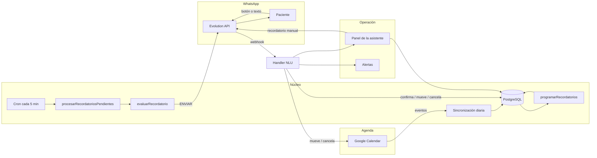
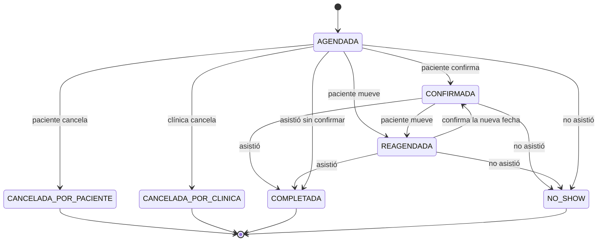
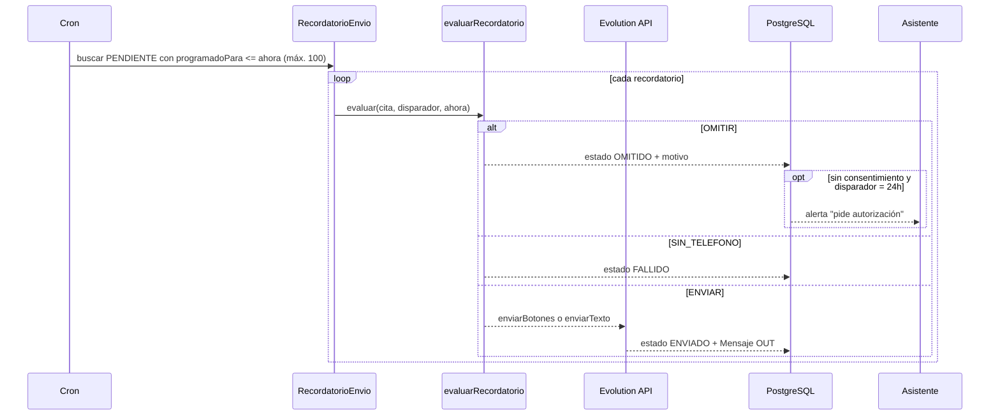

# SPEC-001 — Recordatorios inteligentes con confirmación y reprogramación por WhatsApp

| Campo | Valor |
|---|---|
| **ID** | SPEC-001 |
| **Estado** | Aprobada · implementada · validada |
| **Versión** | 1.0 |
| **Fecha** | 2026-10-30 |
| **Dueño del producto** | Dra. Laura (consultorio dental) |
| **Usuario operativo** | Asistente del consultorio |
| **Autores** | Equipo del proyecto + IA (ver Apéndice A) |
| **Documentos relacionados** | `README.md`, `docs/ARCHITECTURE.md`, `docs/FLUJOS_CONVERSACIONALES.md`, `docs/CALIDAD_CI.md` |
| **Código relacionado** | `src/scheduler/recordatorios.service.ts`, `src/handlers/whatsapp.handler.ts`, `src/services/nlu.ts`, `src/services/mensajes.ts` |

---

## 1. Problema

### 1.1 Contexto

El consultorio de la Dra. Laura atiende con **una sola asistente**. La agenda vive
en Google Calendar y la comunicación con pacientes en WhatsApp, de forma manual.
Cada día la asistente copia citas, escribe recordatorios uno por uno, revisa quién
confirmó y persigue a quien no respondió. Es trabajo repetitivo, variable según el
ánimo y propenso a olvidos.

El README del proyecto parte de una hipótesis de **~30 % de inasistencias**, común
en consultorios pequeños sin recordatorios sistemáticos. No es una medición del
consultorio: es la línea base que esta funcionalidad debe reducir y medir.

### 1.2 Dolencias concretas

1. **La silla vacía.** Un paciente que olvida la cita deja un hueco que no se
   recupera: la Dra. pierde ingreso y otro paciente pierde la oportunidad de atenderse.
2. **El recordatorio manual no escala.** La asistente no puede escribir a 15
   pacientes a la misma hora mientras atiende el mostrador; los mensajes salen
   tarde o no salen.
3. **El paciente no tiene una acción clara.** “Recuérdame” sin botones obliga a
   escribir, y muchas personas no responden porque no saben qué decir.
4. **Reprogramar es caótico.** Si el paciente avisa que no puede, alguien tiene que
   mover el evento, avisar al paciente y recalcular recordatorios. Con prisa, se
   olvida un paso y quedan mensajes contradictorios.
5. **Perseguir al que ya confirmó.** Enviar recordatorios de confirmación a quien
   ya dijo “sí” erosiona la confianza y aumenta los bloqueos.

### 1.3 Declaración del problema

> La asistente no puede garantizar que cada paciente reciba el mensaje correcto,
> en el momento correcto y con una acción de un toque; y cuando el paciente
> responde, el cambio no se refleja de forma confiable en la agenda y en los
> recordatorios futuros.

### 1.4 Por qué una solución genérica no basta

- Un recordatorio calendario no entiende respuestas en español (“cámbiamela para
  el jueves”), no mueve el evento y no avisa a la asistente.
- Una herramienta de marketing masivo no respeta el consentimiento, el horario
  del consultorio ni la relación uno a uno.
- Un bot que diagnostica o promete precios es un riesgo legal y de confianza.

---

## 2. Objetivo y métricas

### 2.1 Resultado esperado

Que **el ciclo completo de una cita** —programar, recordar, confirmar, mover o
cancelar— ocurra sin intervención manual en el caso normal, y que la asistente
sólo intervenga en excepciones y dudas.

### 2.2 Métricas de éxito

| Métrica | Meta inicial | Cómo se mide |
|---|---|---|
| Citas confirmadas al menos 24 h antes | ≥ 60 % | `Cita.estado = CONFIRMADA` antes de `fecha - 24 h` |
| Recordatorios rutinarios enviados sin intervención | 100 % | `RecordatorioEnvio.estado = ENVIADO` sin acción de panel |
| Pacientes que resuelven en ≤ 2 mensajes | ≥ 80 % | Hilo de `Mensaje` por cita |
| Mensajes enviados sin consentimiento | 0 | `RecordatorioEnvio.estado = OMITIDO` con motivo de consentimiento |
| Mensajes duplicados por reintento de webhook | 0 | `Mensaje.proveedorId` único + acción `DUPLICADA` |
| Inasistencias | Reducción medible vs. línea base | `Cita.estado = NO_SHOW` / citas atendibles |

### 2.3 Métricas de guarda (no sacrificar)

- Mensajes fuera de 08:00–21:00: **0**.
- Quejas o bloqueos del número: no aumentar.
- Divergencia entre Calendar y la base después de una reprogramación: **0** en el
  caso feliz; si Calendar falla, debe quedar registro y alerta.
- Tiempo de la asistente en tareas rutinarias: reducir, no trasladar al panel.

---

## 3. Usuarios y trabajos por hacer

### 3.1 Dra. Laura (dueña)

- **Quiere:** que la agenda se llene y que los tratamientos se completen.
- **No quiere:** aprender otra herramienta compleja ni sentirse vigilando un bot.
- **Criterio de confianza:** si el panel dice “confirmada”, es verdad.

### 3.2 Asistente (usuaria diaria)

- **Quiere:** abrir el panel y ver qué requiere su atención, no revisar 40 chats.
- **Necesita:** poder corregir a mano (mover, confirmar, recordar) sin pelear con
  el sistema.
- **Criterio de confianza:** ningún paciente recibe un mensaje raro o repetido.

### 3.3 Paciente

- **Quiere:** saber cuándo es su cita y poder decir “sí” o “no puedo” sin escribir
  un ensayo.
- **No quiere:** sentirse perseguido, recibir mensajes de madrugada ni repetir
  información que ya dio.

### 3.4 Historias de usuario

- **HU-1:** Como paciente, quiero confirmar mi cita con un toque para no escribir.
- **HU-2:** Como paciente, quiero pedir otro horario y recibir confirmación de la
  nueva fecha sin llamar.
- **HU-3:** Como asistente, quiero ver en el panel quién confirmó y quién no, para
  llamar sólo a los casos relevantes.
- **HU-4:** Como asistente, quiero que el sistema no escriba a quien no autorizó
  mensajes y que me avise para pedir permiso.
- **HU-5:** Como dueña, quiero dejar de enviar recordatorios manuales sin perder
  control de la agenda.

---

## 4. Alcance

### 4.1 Dentro del alcance

- Escalera de recordatorios a **3 días, 24 horas, 2 horas y el mismo día**.
- Botones de WhatsApp **“Sí, asistiré”** y **“Necesito cambiarla”**.
- Interpretación de respuestas en español (botón → reglas → LLM opcional).
- Confirmación, reprogramación y cancelación de la cita.
- Movimiento/cancelación del **mismo** evento de Google Calendar.
- Recálculo de recordatorios al mover una cita.
- Ventana de envío 08:00–21:00 y consentimiento explícito.
- Idempotencia ante reintentos del webhook.
- Vista de la conversación y acciones en el panel.
- Alertas a la asistente para excepciones (sin consentimiento, no entendido, duda,
  cita sin confirmar).
- Texto plano de respaldo si los botones fallan.

### 4.2 Fuera del alcance

- Facturación, cobros, pagos en línea o meses sin intereses.
- Expediente clínico, diagnósticos, recetas o imágenes.
- Campañas de marketing masivo o reactivación de pacientes inactivos.
- Lista de espera automática para llenar huecos.
- Voz, llamadas o video.
- Multi-sucursal, multi-consultorio o roles avanzados.
- Firma digital de consentimientos (sólo se registra el booleano autorizado).

---

## 5. Diseño de la solución

### 5.1 Principios de diseño

1. **Calendar manda, Postgres recuerda.** La agenda es la fuente de verdad; la base
   permite consultar rápido y reconstruir el estado.
2. **Cola persistente, no memoria.** Cada envío es una fila con `programadoPara`.
   Si el proceso se reinicia, nada se pierde.
3. **Determinista primero.** Botones y reglas resuelven el 95 % sin LLM. El LLM
   sólo clasifica intención; **nunca calcula fechas**.
4. **Una acción por mensaje.** El paciente no tiene que elegir entre cinco cosas.
5. **Silencio fuera de horario.** Un mensaje a las 3 a.m. es peor que un mensaje
   tarde.
6. **Excepción = humano.** Lo dudoso se escala; el bot no improvisa.
7. **Todo deja rastro.** Cada envío, omisión, error y respuesta queda en la base.

### 5.2 Arquitectura del flujo



### 5.3 Modelo de datos utilizado

No se requieren tablas nuevas; se reutilizan las existentes:

| Tabla | Rol en esta feature |
|---|---|
| `Paciente` | `telefono` (últimos 10 dígitos), `consentWhatsapp`, `nombre` |
| `Cita` | `fecha` (UTC), `estado`, `calendarioEventId`, `titulo`, `tipo` |
| `RecordatorioEnvio` | Cola: `disparador`, `programadoPara`, `estado`, `intentos`, `contenido`, `enviadoA` |
| `Mensaje` | Historial IN/OUT, `proveedorId` único para idempotencia, `citaId` |

Restricción clave: `@@unique([citaId, disparador])` en `RecordatorioEnvio` permite
hacer *upsert* y evita duplicar la programación.

### 5.4 Escalera de recordatorios

| Disparador | Momento | ¿Pide confirmación? | Contenido |
|---|---|---|---|
| `D_MINUS_3D` | 72 h antes | Sí, con botones | “Tienes una cita el… ¿nos confirmas?” |
| `D_MINUS_24H` | 24 h antes | Sí, con botones | “Tu cita es mañana. ¿Sigues viniendo?” |
| `D_MINUS_2H` | 2 h antes | No, texto | “Tu cita es en 2 horas. Te esperamos.” |
| `D_MINUS_0H` | Hora de la cita | No, texto | “¡Hoy es tu cita! Llega 10 minutos antes.” |

Reglas:

- Sólo se programan momentos **futuros**; los que ya pasaron se omiten.
- La programación se recalcula al crear/mover una cita y en la reconciliación
  nocturna.
- Un recordatorio de 3 días que se programaría con menos de 48 h de anticipación
  se omite: llega tarde y confunde.
- Los dos primeros usan botones; si el envío con botones falla, se cae a texto
  plano con la misma información.

### 5.5 Estados de la cita



Estados terminales para recordatorios: `CANCELADA_POR_PACIENTE`,
`CANCELADA_POR_CLINICA`, `COMPLETADA`, `NO_SHOW`. En ellos no se envía nada.

### 5.6 Flujo de envío (cron cada 5 minutos)



Reglas de elegibilidad (`evaluarRecordatorio`):

| Condición | Resultado | Motivo |
|---|---|---|
| Estado cancelado/completado/no-show | `OMITIR` | `Cita en estado …` |
| `consentWhatsapp = false` | `OMITIR` | `Sin consentimiento para WhatsApp` |
| Cita con más de 1 h de haber pasado | `OMITIR` | `La cita ya pasó` |
| Ya `CONFIRMADA` y el disparador pide confirmación | `OMITIR` | `El paciente ya confirmó` |
| `D_MINUS_3D` con menos de 48 h de anticipación | `OMITIR` | `Ventana del recordatorio vencida` |
| Sin teléfono | `SIN_TELEFONO` | Se marca `FALLIDO` |
| Caso contrario | `ENVIAR` | — |

### 5.7 Flujo de confirmación

1. El paciente toca **“Sí, asistiré”** (`botonId = confirmar_cita`).
2. El webhook se valida y se deduplica por `proveedorId`.
3. El NLU resuelve `CONFIRMAR` con confianza 0.99 y fuente `boton`.
4. Se actualiza `Cita.estado = CONFIRMADA`.
5. Se responde “Tu cita quedó confirmada…” y se registra el mensaje OUT.
6. Los recordatorios de 3 días y 24 h pendientes se **omiten** (ya confirmó). Los
   avisos de 2 h y del día **sí se envían** porque son logísticos, no de confirmación.
7. El panel muestra la cita como “Confirmada” sin intervención.

Si el paciente escribe “sí, ahí estaré” en lugar de usar el botón, las reglas
deterministas producen el mismo resultado.

### 5.8 Flujo de reprogramación

1. El paciente toca **“Necesito cambiarla”** (`botonId = reprogramar_cita`) o
   escribe una frase como “no puedo ir, cámbiamela para el jueves a las 5”.
2. El NLU resuelve `REPROGRAMAR` y extrae fecha/hora si existen.
3. `resolverNuevaFecha` calcula la nueva fecha:
   - Si hay fecha explícita, se usa (nunca en el pasado).
   - Si no, se proponen **3 días después** a la misma hora.
   - Si cae domingo (consultorio cerrado), se mueve al lunes.
   - Si la fecha propuesta ya pasó, se busca la siguiente ocurrencia.
4. Se mueve **el mismo evento** de Google Calendar (`moverEvento`), no se crea otro.
   Si Calendar falla, se registra el error y se continúa con la base (la asistente
   debe reconciliar).
5. Se actualiza `Cita.fecha` y `estado = REAGENDADA`.
6. Se recalculan los recordatorios para la nueva fecha.
7. Se responde con la nueva fecha y se registra el mensaje.
8. El panel refleja la nueva fecha y el estado “Movida”.

### 5.9 Flujo de cancelación

1. El paciente dice “cancelo mi cita” o usa un botón de cancelación.
2. El NLU resuelve `CANCELAR`.
3. Se cancela el evento de Calendar (si existe); un fallo se registra.
4. Se actualiza `Cita.estado = CANCELADA_POR_PACIENTE`.
5. Se responde con tono cálido, sin culpa, y se deja la puerta abierta.
6. Los recordatorios pendientes se omiten en el siguiente ciclo.

### 5.10 Flujo cuando no se entiende

- Se responde con ejemplos (“Sí, confirmo” / “No puedo, cámbiamela para el jueves”).
- Se registra una alerta para la asistente con el texto original.
- No se cambia ningún estado de la cita.
- Si el teléfono no tiene cita asociada, se pide nombre completo y fecha, y se
  alerta a la asistente.

### 5.11 Ventana de envío y zona horaria

- Ventana: **08:00 ≤ hora < 21:00** en `TIMEZONE`.
- Si el cron corre fuera de ventana, **no envía**: mueve los pendientes vencidos a
  las 08:00 del mismo día o del siguiente.
- Toda fecha se guarda en UTC y se interpreta/muestra en la zona del consultorio.
- El cálculo de “3 días”, “24 horas”, etc. se hace sobre instantes, no sobre texto.

### 5.12 Idempotencia y reintentos

- **Webhook:** `Mensaje.proveedorId` es único. Si Evolution reintenta, el handler
  devuelve `DUPLICADA` sin repetir efectos.
- **Programación:** `@@unique([citaId, disparador])` + `upsert`; reprogramar
  actualiza la misma fila.
- **Envío:** sólo se procesan filas `PENDIENTE`; al enviar se marca `ENVIADO`
  inmediatamente. Si el proceso muere entre el envío y el marcado, se reenvía como
  máximo una vez (trade-off explícito: mejor un duplicado raro que un olvido).
- **Fallos de WhatsApp:** hasta 3 intentos; luego `FALLIDO` y alerta.
- **Lote:** máximo 100 recordatorios por ciclo para no saturar la API.

### 5.13 Superficies

| Superficie | Qué hace |
|---|---|
| `POST /webhook/whatsapp` | Recibe mensajes, valida secreto, deduplica y orquesta |
| Cron `*/5 * * * *` | Procesa la cola de recordatorios |
| Cron diario 08:00 | Reconciliación Calendar → Postgres |
| Cron diario 09:00 | Alerta de citas sin confirmar |
| `GET /panel` | Agenda, pendientes, tratamientos, pacientes, conversaciones |
| `POST /api/panel/citas/:id/recordatorio` | Envío manual (1 intento, 5 s) |
| `POST /api/panel/citas/:id/reprogramar` | Reprogramación asistida |
| `GET /health` | Estado de Postgres, WhatsApp y LLM |

### 5.14 Errores y escalado

| Situación | Comportamiento | A quién avisa |
|---|---|---|
| WhatsApp caído | Reintenta 3 veces; marca `FALLIDO` | Alerta a la asistente |
| Botones no soportados | Envía texto plano | — |
| Calendar caído al mover | Registra error; actualiza la base | Alerta en logs/panel |
| Paciente sin consentimiento | No envía; marca `OMITIDO` | Alerta única en el recordatorio de 24 h |
| Paciente sin teléfono | No envía; marca `FALLIDO` | Panel lo muestra |
| Mensaje no entendido | Pide aclaración con ejemplos | Alerta con texto original |
| Duda administrativa | Responde lo frecuente o escala | Alerta a la asistente |
| Webhook duplicado | Devuelve `DUPLICADA` | — |

### 5.15 Privacidad y seguridad

- Sólo se envían nombre de pila, fecha, hora y motivo del tratamiento. Nada de
  diagnósticos, medicamentos ni datos clínicos.
- El teléfono se guarda con los últimos 10 dígitos; el país se antepone al enviar.
- El webhook puede exigir `x-webhook-secret` (comparación en tiempo constante).
- El panel exige Basic auth si `PANEL_PASSWORD` está definida; sin contraseña sólo
  acepta loopback.
- Los logs no incluyen credenciales ni contenido clínico.

---

## 6. Criterios de aceptación

> Cinco criterios, todos ejecutables. La columna **Verificación** apunta a pruebas
> automatizadas que ya existen en el repositorio; el comando base es
> `npm test`. Si un criterio falla, la feature no está terminada.

### AC-01 — La escalera de recordatorios es completa y ordenada

**Dado** una cita agendada con consentimiento y teléfono,
**cuando** se programan sus recordatorios,
**entonces** existen exactamente cuatro momentos únicos: 72 h, 24 h, 2 h y 0 h
antes; los dos primeros piden confirmación con botones y los dos últimos son
avisos de texto.

**Verificación automatizada**

- `tests/unit/recordatorios.test.ts › calcularMomento › D_MINUS_3D se programa 72 horas antes`
- `tests/unit/recordatorios.test.ts › calcularMomento › D_MINUS_24H se programa 24 horas antes`
- `tests/unit/recordatorios.test.ts › calcularMomento › D_MINUS_2H se programa 2 horas antes`
- `tests/unit/recordatorios.test.ts › calcularMomento › D_MINUS_0H se programa 0 horas antes`
- `tests/unit/recordatorios.test.ts › calcularMomento › cubre la escalera completa de recordatorios`
- `tests/unit/recordatorios.test.ts › construirTexto › el recordatorio de 3 días pide confirmación`
- `tests/unit/recordatorios.test.ts › construirTexto › el de 2 horas menciona el tiempo restante y la hora`

**Comando**

```bash
npx vitest run tests/unit/recordatorios.test.ts
```

### AC-02 — El paciente confirma con un toque y no se le vuelve a preguntar

**Dado** un paciente con cita `AGENDADA` y consentimiento,
**cuando** toca el botón **“Sí, asistiré”**,
**entonces** la cita pasa a `CONFIRMADA`, recibe una respuesta de confirmación,
se registra el mensaje saliente y un reintento del mismo webhook no repite la
acción; además, los recordatorios de 3 días/24 h pendientes se omiten y el aviso
de 2 h sí se envía.

**Verificación automatizada**

- `tests/unit/handler.test.ts › procesarEntrante › confirma con el botón de WhatsApp sin escribir`
- `tests/unit/handler.test.ts › procesarEntrante › confirma la cita y responde al paciente`
- `tests/unit/handler.test.ts › procesarEntrante › no procesa dos veces el mismo mensaje de WhatsApp`
- `tests/unit/recordatorios.test.ts › evaluarRecordatorio › no vuelve a pedir confirmación si el paciente ya confirmó`
- `tests/unit/recordatorios.test.ts › evaluarRecordatorio › sí envía el aviso de 2 horas aunque el paciente haya confirmado`

**Comando**

```bash
npx vitest run tests/unit/handler.test.ts tests/unit/recordatorios.test.ts
```

### AC-03 — Reprogramar mueve la misma cita y recalcula sus recordatorios

**Dado** una cita con evento en Google Calendar,
**cuando** el paciente toca **“Necesito cambiarla”** o escribe una frase equivalente,
**entonces** se mueve **el mismo** evento, la cita queda `REAGENDADA` con una fecha
futura (nunca domingo ni pasado), se recalculan sus recordatorios y el paciente
recibe la nueva fecha.

**Verificación automatizada**

- `tests/unit/handler.test.ts › procesarEntrante › reprograma con el botón y mueve el mismo evento`
- `tests/unit/handler.test.ts › procesarEntrante › reprograma con lenguaje natural, mueve el evento y recalcula recordatorios`
- `tests/unit/handler.test.ts › resolverNuevaFecha › sin fecha explícita propone 3 días después a la misma hora`
- `tests/unit/handler.test.ts › resolverNuevaFecha › nunca propone un domingo (consultorio cerrado)`
- `tests/unit/handler.test.ts › resolverNuevaFecha › no acepta una fecha en el pasado`
- `tests/unit/handler.test.ts › resolverNuevaFecha › respeta la hora pedida por el paciente`

**Comando**

```bash
npx vitest run tests/unit/handler.test.ts
```

### AC-04 — Nunca se escribe fuera del horario del consultorio

**Dado** un recordatorio vencido a las 03:00 o a las 21:00,
**cuando** corre el cron,
**entonces** no se envía ningún mensaje; el pendiente se reprograma a las 08:00
del mismo día o del siguiente, sin perderse ni adelantarse en el tiempo.

**Verificación automatizada**

- `tests/unit/recordatorios.test.ts › proximoHorarioPermitido › no toca los mensajes dentro del horario de atención`
- `tests/unit/recordatorios.test.ts › proximoHorarioPermitido › mueve a las 08:00 los mensajes de madrugada`
- `tests/unit/recordatorios.test.ts › proximoHorarioPermitido › mueve al día siguiente los mensajes de la noche`
- `tests/unit/recordatorios.test.ts › proximoHorarioPermitido › nunca devuelve un instante anterior al recibido`

**Comando**

```bash
npx vitest run tests/unit/recordatorios.test.ts
```

### AC-05 — Elegibilidad: sin consentimiento o sin cita vigente no se envía

**Dado** un paciente sin consentimiento, una cita cancelada/completada/no-show,
una cita ya pasada o un paciente sin teléfono,
**cuando** vence un recordatorio,
**entonces** no se llama a WhatsApp: se marca `OMITIDO` con el motivo (o `FALLIDO`
si falta teléfono), y si la falta de consentimiento ocurre en el recordatorio de
24 h se envía **una sola** alerta a la asistente para pedir autorización.

**Verificación automatizada**

- `tests/unit/recordatorios.test.ts › evaluarRecordatorio › envía cuando hay consentimiento, teléfono y la cita sigue vigente`
- `tests/unit/recordatorios.test.ts › evaluarRecordatorio › omite sin consentimiento y explica por qué`
- `tests/unit/recordatorios.test.ts › evaluarRecordatorio › omite una cita cancelada`
- `tests/unit/recordatorios.test.ts › evaluarRecordatorio › omite un recordatorio de 3 días que llega con menos de 48 horas`
- `tests/unit/recordatorios.test.ts › evaluarRecordatorio › omite una cita que ya pasó`
- `tests/unit/recordatorios.test.ts › evaluarRecordatorio › marca sin teléfono cuando falta el número`

**Verificación de la alerta única:** el código sólo dispara
`AlertService.enviar` cuando `motivo === SIN_CONSENTIMIENTO` **y**
`disparador === D_MINUS_24H` (ver `src/scheduler/recordatorios.service.ts`).
La prueba E2E manual del Apéndice B permite confirmarlo con un paciente demo.

---

## 7. Casos borde

| Caso | Comportamiento esperado |
|---|---|
| Paciente responde “ok” o “sí” | Reglas lo interpretan como confirmación |
| Paciente responde con audio o imagen | Se ignora el contenido no textual; se pide texto |
| Paciente escribe desde otro número | No hay cita asociada; se pide nombre y fecha |
| Paciente tiene dos citas activas | Se usa la primera; **riesgo conocido** (ver pregunta abierta Q-3) |
| Cita justo a las 08:00 | El aviso de 0 h se envía dentro de ventana; el de 2 h pudo diferirse |
| Cambio de horario de verano | México ya no aplica DST; aun así, todo pasa por `timeUtils` |
| Evento de Calendar sin formato “Nombre - motivo” | Se ignora en la sincronización |
| Paciente confirma después de la cita | Se actualiza el estado, pero no se envían recordatorios vencidos |
| Reprogramación a domingo | Se mueve al lunes |
| Reprogramación a fecha pasada | Se busca la siguiente ocurrencia futura |
| WhatsApp devuelve error temporal | Reintenta hasta 3 veces; luego alerta |
| Evolution reintenta el webhook | `DUPLICADA`; sin efectos duplicados |
| Paciente pide cancelar y luego volver | Puede agendar de nuevo; el historial queda |
| LLM no configurado | Reglas + botones siguen funcionando; lo ambiguo se escala |

---

## 8. Requisitos no funcionales

| Categoría | Requisito |
|---|---|
| **Latencia** | Un recordatorio vence y se envía en ≤ 5 min (periodo del cron) |
| **Disponibilidad** | Si el proceso se reinicia, la cola persiste y se retoma |
| **Escalabilidad** | Hasta 100 recordatorios por ciclo; suficiente para un consultorio pequeño |
| **Observabilidad** | Logs de envío, omisión, error y reconciliación; `/health` veraz |
| **Privacidad** | Consentimiento obligatorio; minimización de datos; sin contenido clínico |
| **Seguridad** | Secreto de webhook opcional; panel con Basic auth o loopback |
| **Mantenibilidad** | NLU determinista y probado; LLM aislado y opcional |
| **Accesibilidad del panel** | Contraste AA, foco visible, botones ≥ 44 px, estados con texto |

---

## 9. Dependencias

- **PostgreSQL 16** con migraciones de Prisma aplicadas.
- **Evolution API v2** conectada a un número de WhatsApp (QR escaneado).
- **Google Calendar API** con OAuth2 y refresh token válido; app publicada.
- **Zona horaria** `America/Mexico_City` (configurable).
- Variables: `DATABASE_URL`, `EVOLUTION_*`, `GOOGLE_*`, `TIMEZONE`,
  `WHATSAPP_PAIS`, `PANEL_*`, `LLM_*` (opcional).
- Para el envío real: teléfono del consultorio con WhatsApp y plantilla/botones
  aceptados por Evolution.

---

## 10. Riesgos y mitigaciones

| Riesgo | Impacto | Mitigación |
|---|---|---|
| Baileys no es API oficial; posible bloqueo | Alto | Número dedicado, límites de envío, evaluar Cloud API |
| Botones no disponibles en alguna versión | Medio | Fallback a texto plano |
| Refresh token de Google caduca (app en Testing) | Alto | Publicar la app; renovar token; alerta en `/health` |
| Calendar caído al mover | Medio | Registrar error, actualizar base, reconciliar después |
| Webhook duplicado | Medio | `proveedorId` único + `DUPLICADA` |
| LLM alucina una fecha | Alto | El LLM **no** calcula fechas; sólo clasifica; fechas por reglas |
| Paciente con dos citas activas | Medio | Pregunta abierta Q-3; por ahora se elige la primera |
| Mensaje enviado dos veces si el proceso muere | Bajo | Trade-off aceptado; se marca inmediatamente después |
| Datos personales en logs | Alto | Revisión de logs; no incluir contenido clínico |
| Domingo/DST mal calculado | Medio | `utils/time.ts` + pruebas de zona |

---

## 11. Plan de reconstrucción (SDD)

La funcionalidad ya existía; este cambio la **reconstruye desde la spec** y cierra
huecos de verificabilidad:

| Fase | Entregable | Estado |
|---|---|---|
| F0 | Problema, alcance y criterios verificables (esta spec) | ✅ |
| F1 | Pruebas de aceptación de la escalera, confirmación, reprogramación y horario | ✅ existentes |
| F2 | Extraer `evaluarRecordatorio` como función pura y probar consentimiento/estado | ✅ |
| F3 | Pruebas de botón de confirmación y botón de reprogramación | ✅ |
| F4 | `typecheck`, suite completa y build | ✅ 120 pruebas |
| F5 | E2E con Evolution y Google reales | ⏳ requiere credenciales |

**Fuera de esta reconstrucción:** rediseño visual del panel, waitlist automática,
métricas históricas y migración a WhatsApp Cloud API.

---

## 12. Preguntas abiertas

- **Q-1:** ¿El aviso de 2 h debe omitirse si el paciente confirmó? Hoy se envía
  porque es logístico. Decidir con datos de quejas.
- **Q-2:** Si el paciente toca “Necesito cambiarla” sin proponer fecha, hoy se
  propone +3 días a la misma hora. ¿Conviene preguntar antes de mover?
- **Q-3:** Si un teléfono tiene dos citas activas, hoy se toma la primera. ¿Se
  debe preguntar “¿cuál cita?” o asociar por el último recordatorio enviado?
- **Q-4:** ¿Se debe capturar el motivo de cancelación para analítica? Hoy sólo se
  guarda la nota libre.
- **Q-5:** ¿La plantilla de botones está aprobada en el número real? Verificar en
  la puesta en marcha.

---

## Apéndice A — Prompt usado y mejoras aplicadas

**Prompt base (IA):**

> Actúa como product manager de un consultorio dental pequeño. Escribe la spec de
> la funcionalidad más importante del sistema: recordatorios por WhatsApp que
> reduzcan inasistencias. Incluye problema, usuarios, alcance, diseño, flujo,
> errores y 3–5 criterios de aceptación verificables. Español, tono profesional,
> sin inventar métricas del consultorio.

**Mejoras aplicadas tras revisar el código y las pruebas:**

1. Se separó “confirmación” de “recordatorio logístico”: el aviso de 2 h **no** se
   omite al confirmar; el de 24 h sí. El borrador los trataba igual.
2. Se documentó el caso “3 días con menos de 48 h” (`Ventana del recordatorio
   vencida`), que el borrador no contemplaba.
3. Se cambió “el LLM interpreta fechas” por “el LLM sólo clasifica; las fechas se
   calculan con reglas”, que es lo que hace el código y evita alucinaciones.
4. Se añadió el trade-off de idempotencia (“mejor un duplicado raro que un olvido”)
   porque el envío y el marcado no son transaccionales.
5. Se acotaron los criterios a pruebas reales y se añadieron pruebas para
   `evaluarRecordatorio` y los botones, que faltaban.
6. Se eliminaron métricas inventadas: la única cifra (~30 %) queda marcada como
   hipótesis del README, no como medición.

---

## Apéndice B — Evidencia de validación (2026-10-30)

Comandos ejecutados desde la raíz del proyecto:

```text
npm run typecheck   → OK (sin errores)
npm test            → 120 pruebas, 8 archivos, 0 fallos
npm run build       → OK
```

Cobertura de los criterios:

| Criterio | Evidencia |
|---|---|
| AC-01 | `calcularMomento` + `construirTexto` (7 pruebas) |
| AC-02 | Handler: confirmación por botón, texto y deduplicación (5 pruebas) |
| AC-03 | Handler: botón, lenguaje natural y `resolverNuevaFecha` (6 pruebas) |
| AC-04 | `proximoHorarioPermitido` (4 pruebas) |
| AC-05 | `evaluarRecordatorio` (8 pruebas) + revisión del código de alerta |

**Pendiente de verificación real (no bloquea la spec):**

- Enviar un recordatorio real por Evolution y recibir el botón en un teléfono.
- Mover un evento real de Google Calendar y comprobar que no se duplica.
- Confirmar que la plantilla de botones está aprobada en el número del consultorio.

---

## Historial de cambios

| Versión | Fecha | Cambio |
|---|---|---|
| 1.0 | 2026-10-30 | Spec inicial validada contra el código; se añaden criterios AC-01…AC-05, pruebas de `evaluarRecordatorio` y de botones. |
